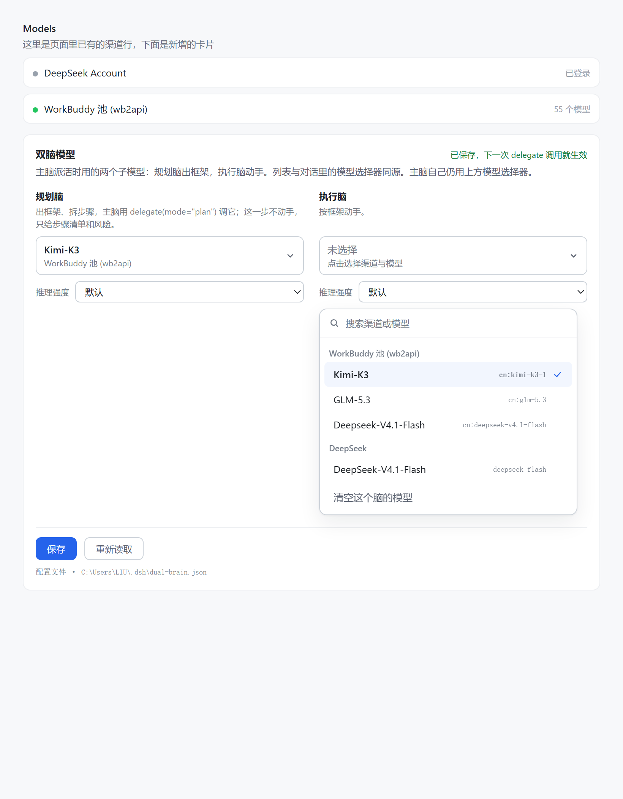

# dsh-shuangnao · 双脑

给 [DeepSeek Harness](https://github.com/deepseek-ai) 用的双模型插件：**一个主脑管规划与验收，动手的活交给另一个模型在独立会话里干**。

> 它解决的不是"换模型"——那件事右上角就能做。它解决的是"同一件事，两个模型分工"。

---

## 它和手动切模型有什么区别

| | 手动切模型 | 双脑 |
|---|---|---|
| 同一轮里两个模型同时工作 | 做不到。切到谁就是谁 | 主脑在等，执行脑在改文件 |
| 按角色分流 | 做不到，只能按时间段切 | 想一步用规划脑，做一步用执行脑 |
| 上下文 | 切了模型，对话还是那一份，越滚越大 | 执行脑是独立子会话，只带任务本身 |
| 生效方式 | 影响整段对话 | 每次调用现读配置，不打断主脑 |

---

## 三个角色

| 角色 | 谁在用 | 模型从哪来 |
|---|---|---|
| **主脑** | 跟你对话的那个 | 右上角模型选择器（原生，插件平时不碰） |
| **规划脑** | 计划模式期间的主脑 | 面板里的 `plan` 槽 |
| **执行脑** | `delegate` 起的子会话 | 面板里的 `exec` 槽 |

## 三个自动化（都在这一个插件里）

1. **进 `/plan` → 主脑换成规划脑。**
   请求层接管，退出即还原。右上角不显示变化（我们改的是路由，不是 UI 状态）。

2. **A：批准计划 → 自动交棒执行脑。**
   `exit_plan_mode` 只有在计划审核里点「批准」时才返回成功。插件在这个时刻用执行脑起一个子会话，prompt 里带工作目录 + 计划全文 + 交付要求，并告诉主脑「别再动手，等回报验收」。

3. **C：批准计划 → 会话模型也切到执行脑。**
   走 `sessionController.selectModel`（和手动切换同一条 API），所以右上角会跟着变。

```
你：/plan 把这模块重构一下
  ↓
主脑 = 规划脑 → 写计划 → exit_plan_mode 弹审核
  ↓
你点「批准」                      ← 唯一的动作
  ├─ A：执行脑起子会话（另一个上下文）动手
  └─ C：会话模型切到执行脑（右上角可见）
  ↓
执行脑改文件、跑测试 → 结果回流主脑 → 主脑验收 → 回你
```

---

## 安装

```powershell
dsh plugin --profile desktop add "link:D:/path/to/dsh-shuangnao"
```

`package.json` 里 `dsh.bundle.patch` 指向 `cordis.patch.yml`，装好即插：

- 宿主半侧：注册 `/dual-brain/*`（配置读写、模型目录、诊断）；
- preset `brain-live`（显示名「双脑·可热切换」）：人设 + 标准工具 + `delegate` 工具；
- 浏览器半侧：`dsh.client` 声明的设置卡片。

**加载后必须重启一次**，preset 才进注册表。卸载：

```powershell
dsh plugin --profile desktop remove dsh-dual-brain-live
```

（包名是 `dsh-dual-brain-live`，仓库名是 `dsh-shuangnao`。）

## 配置

界面：**设置 → Models → 最下方「双脑模型」卡片**。两个槽各有一个按渠道分组、可搜索的选择器。

文件：`~/.dsh/dual-brain.json`

```json
{
  "plan": { "provider": "wbpool", "model": "cn:glm-5.3",           "reasoningEffort": "" },
  "exec": { "provider": "wbpool", "model": "cn:deepseek-v4.1-flash", "reasoningEffort": "" }
}
```

- 保存后**下一次** `delegate` / 下一次请求就生效，不用重启；
- 槽位留空 = 不接管（计划模式会保持你自己的模型，不会报错）；
- `reasoningEffort` 留空表示交给模型默认。

## 用

- **`delegate`**（工具）：`{prompt, description, mode?: "plan"|"exec"}`
  主脑随时可以把一件自包含的活扔给规划脑或执行脑，子会话有自己的上下文，所以 `prompt` 必须自包含。
- **`/plan`**（DSH 原生命令）：进入计划模式，此时主脑就是规划脑。
- **计划审核**：写完计划后主脑调 `exit_plan_mode`，你点批准即触发 A + C。

---

## 验证

### 看哪颗脑写的计划

```powershell
node _who-wrote-plan.mjs          # 最近一个会话
node _who-wrote-plan.mjs --all    # 最近三个
```

解压 `~/.dsh/sessions/**/session.v4.jsonl.zstd`（多帧 zstd，Node 原生只解第一帧，脚本按 magic 切帧 + 按 seq 去重），按序打印 `plan/mode` 与 `request/header`：

```
turn 1  DEFAULT  wbpool / cn:deepseek-v4.1-flash   (initial)
[PLAN ON ] plan mode entered  (seq 7)
turn 2  PLAN     wbpool / cn:glm-5.3              ← 计划是它写的
[PLAN OFF] plan mode left     (seq 41)
turn 3  DEFAULT  wbpool / cn:deepseek-v4.1-flash
```

### 看插件自己的判断

宿主/Agent 侧的每个关键判断都会落盘到 `%TEMP%\dual-brain-trace.log`（超过 200KB 自动清空）：

```powershell
Get-Content $env:TEMP\dual-brain-trace.log -Tail 12
```

```
pre-step route=wbpool/cn:glm-5.3
assemble route=wbpool/cn:glm-5.3
request  route=wbpool/cn:glm-5.3  inner=wbpool/cn:deepseek-v4.1-flash
handoff  started child=child-xxx
session model switched to wbpool/cn:deepseek-v4.1-flash
```

`inner=` 是 sessionController 给你的值，`route=` 是最终生效的，两者不同才说明接管成功。

### 宿主自检

```powershell
(Invoke-WebRequest http://127.0.0.1:19387/dual-brain/diag).Content | ConvertFrom-Json | ConvertTo-Json -Depth 6
```

返回 `registry`（能否看到 `agentPresets` 服务）、`presets[]`（含每个 preset 的 `broken` 失败原因）、`modules`（模块解析探针）。

---

## 已知限制

| 限制 | 说明 |
|---|---|
| 进 `/plan` 时右上角不变 | 计划模式在请求层接管，不动 UI 状态；只有批准后（C）才会变 |
| C 会改默认模型 | `selectModel` 内部会 `saveSelection`，批准一次后新会话默认就是执行脑。改成别的模型即可恢复 |
| C 可能被图片卡住 | 走 `serializeImageAdmission`，会话里有待发送图片时切换会排队或失败（trace: `switch failed`） |
| **双写风险（A+C 同时开）** | 执行脑在子会话动手，主脑又是执行模型，主脑可能自己也干。根治需要"写操作门禁"（未实现） |
| 不能自动进计划模式 | `planMode` 服务被 preset 的 `isolate: {planMode: true}` 锁住，组外拿不到，触发仍靠 `/plan` |
| 子代理后端 | `delegate` 用 `spawn`，ACP/Codex/Claude Code 后端不接受 `agentOptions` |
| 上下文 | 子会话看不到当前对话，`prompt` 必须自包含 |

## 排错

| 现象 | 先看 | 常见原因 |
|---|---|---|
| 预设显示「加载失败」 | `diag` 里的 `broken` | 某行插件缺必填 `config`（如 `plan-mode` 的 `section`）、包名写错 |
| 列表里没有「双脑·可热切换」 | 插件列表是否启用、是否重启 | preset 层在启动时装载 |
| `/plan` 后计划不是规划脑写的 | `_who-wrote-plan.mjs` | 会话没用 `brain-live` preset（老会话插件树固定）；或 `plan` 槽为空 |
| 批准后没起子会话 | trace 是否有 `handoff` | 不是 `exit_plan_mode`、计划文本取不到、`exec` 槽为空、同一计划已交棒 |
| 批准后右上角没变 | trace 是否有 `session model switched` | 有 = 客户端没收到推送；没有 = `selectModel` 调用失败 |

---

## 开发

```powershell
node _offline-test.mjs    # 宿主路由 + delegate 路由 + 计划模式接管 + 交棒 + C（14 条断言）
node _render-test.mjs     # 卡片渲染（11 条断言，vm + 假 React）
node _measure.mjs         # 用 playwright-core 量真实布局，防止两列错位
node _preview.mjs         # 生成静态预览页（改样式时看效果）
```

`_probe-ui.mjs` 是探活脚本（DSH Web UI 需要鉴权，通常只能拿到 401）。



## 踩坑记录（给后来者）

1. **`waterfall` 是「先注册的在最外层，返回值才算数」**
   `sessionController` 在 agent 创建时就 `installModelSelection`，比插件挂在 `agent/created` 里的钩子早。不 `{ prepend: true }` 就会：我们在内层返回规划脑 → 它在外层 `next()` 之后把 `provider/model` 写回用户的选择。

2. **`assemble` 早于 `pre-step`**
   任何"在 `pre-step` 算好、让 `assemble` 抓快照、`request` 再用"的写法都会拿到空值。路由决策必须在 `agent/request` 里现算。

3. **`session.events` 不一定存在**
   真实字段是 `session.log`（数组）。按 `Array.isArray(events)` 判断会静默返回 false。

4. **工具执行对象的参数在 `exec.arguments`**
   不是 `args` / `input` / `parameters`；工具名在 `exec.name`。

5. **Loader 的 `baseUrl` 是 profile 目录，不是 bundle 目录**
   所以 preset 里的行名只能用包名（`dsh-dual-brain-live/agent`），写 `./lib/agent.js` 会解析到 profile 下不存在的路径。

6. **preset 的插件树要跟当前版本的 `standard` 对齐**
   `plan-mode` 在新版本里 `section` 是必填。照抄旧版本的 preset 会挂。
